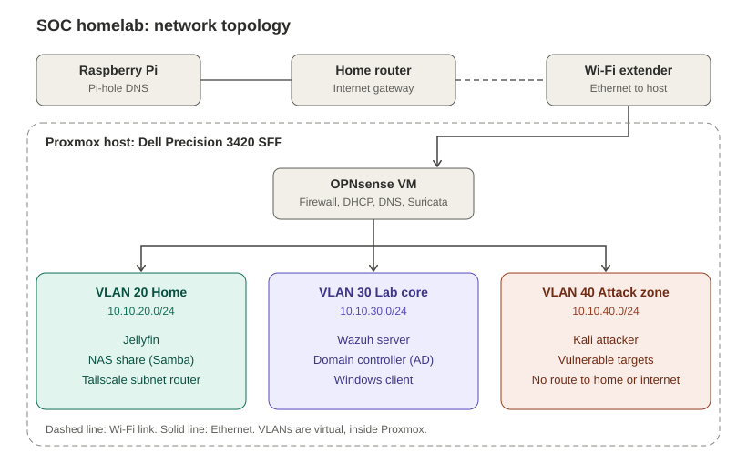
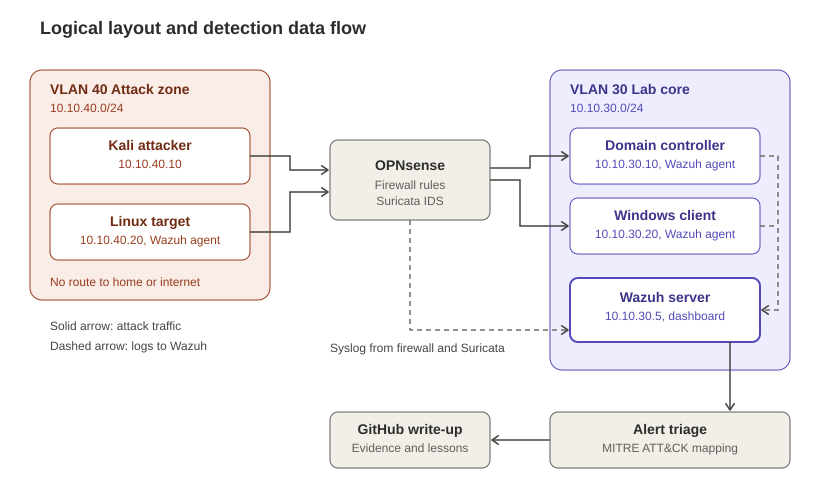

# SOC Homelab

A single-host homelab built to practice what a SOC analyst does day to day: segment a network, collect logs, run controlled attacks, and write up how each one shows up in the SIEM.

**Status:** rebuild in progress. Proxmox is installed. Everything else below is the design I am building toward, and each item is marked done or planned in [docs/build-log.md](docs/build-log.md).



## Goals

1. Build a segmented network with a real firewall, not a flat home LAN.
2. Run Active Directory and a SIEM the way a small company would.
3. Attack my own lab on purpose, then find the evidence in the logs.
4. Document every scenario as attack, detection, and lesson learned.

## Stack

| Layer | Tool | Role |
|---|---|---|
| Hypervisor | Proxmox VE | Runs every VM and container on one host |
| Firewall | OPNsense (VM) | Routing, VLANs, DHCP, DNS, Suricata IDS |
| Identity | Windows Server 2022 Active Directory | Domain controller plus a joined Windows client |
| SIEM | Wazuh | Agent logs, firewall logs, alerting, MITRE ATT&CK mapping |
| Attacker | Kali Linux | Generates the traffic I need to detect |
| Targets | Vulnerable Linux and Windows VMs | Deliberately weak machines in an isolated zone |
| DNS filtering | Pi-hole on a Raspberry Pi | Ad and tracker blocking for the home network |
| Media and storage | Jellyfin and a Samba share | Home services on their own VLAN |
| Remote access | Tailscale | Private access to the NAS, nothing else |

## Hardware

| Part | Spec |
|---|---|
| Host | Dell Precision 3420 SFF |
| CPU | Intel Core i7-6700 |
| RAM | 32 GB |
| Boot and VM storage | 1 TB NVMe |
| Bulk storage | 2 TB WD Red HDD (planned) |
| Extras | Raspberry Pi for Pi-hole, TP-Link TL-SG105E smart switch (planned) |

## Network at a glance

| VLAN | Name | Subnet | Purpose |
|---|---|---|---|
| none | Upstream | Home router range | Proxmox host, Pi-hole, my laptop |
| 20 | Home | 10.10.20.0/24 | Jellyfin, NAS, Tailscale router |
| 30 | Lab core | 10.10.30.0/24 | Wazuh, Active Directory, Windows client |
| 40 | Attack zone | 10.10.40.0/24 | Kali and vulnerable targets, no internet |

Full tables, firewall rules, and Proxmox bridge layout: [docs/network-and-ip-plan.md](docs/network-and-ip-plan.md).

## How detection works here



Attack traffic goes from the attack zone through OPNsense into the lab core. Wazuh agents on the Windows and Linux machines and syslog from OPNsense all land in one Wazuh server, where alerts are triaged and written up.

## Detection scenarios

Each write-up follows the same template: [detections/_template.md](detections/_template.md).

| # | Scenario | MITRE ATT&CK | Status |
|---|---|---|---|
| 1 | [SSH brute force](detections/01-ssh-brute-force.md) | T1110.001 | Planned |
| 2 | [Password spray against Active Directory](detections/02-ad-password-spray.md) | T1110.003 | Planned |
| 3 | [Network scan](detections/03-network-scan.md) | T1046 | Planned |
| 4 | [New local admin account](detections/04-new-local-admin.md) | T1136.001 | Planned |

## Repository layout

```
.
├── README.md
├── diagrams/            SVG diagrams used in the docs
├── docs/
│   ├── architecture.md
│   ├── network-and-ip-plan.md
│   ├── build-log.md
│   └── publishing-checklist.md
├── detections/          One write-up per attack scenario
└── website/             Standalone page for my portfolio site
```

## What I am learning

- How VLAN isolation and firewall rules actually shape what an attacker can reach.
- Which Windows and Linux events matter, and which are noise.
- How to tell a real alert from a tuning problem.
- How to write findings so another analyst can follow them.

## Safety note

All attack tooling runs only against machines in this lab, inside the isolated attack zone, with no route to the home network or the internet.

## Contact

Jay Patel, Brantford, Ontario. [LinkedIn](https://www.linkedin.com/in/pateljayd97)
